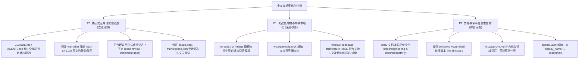

# 调研报告：当前项目对中文友好度的现状分析与无损优化方案

> 调研时间：2026-11-10  
> 调研对象：`BanShan-Alec/skills`（Fork 自 `mattpocock/skills`）  
> 核心约束：**大幅提升中文用户与中文项目开发者的使用体验，同时 100% 保持原有技能架构、执行逻辑与插件规范的兼容性，绝对不破坏现有功能。**

---

## 1. 调研背景与核心发现

当前仓库是基于 Matt Pocock 的 `mattpocock-skills` 的个人 fork 版本。在该 fork 的前期演进中，已经完成了关键的第一步：
- [README.md](file:///h:/mattpocock-skills/README.md) 已经完整翻译为中文（commit `8e261c7`）。
- 28 个正式技能的 `SKILL.md` frontmatter 中的 `description` 已经替换为简洁中文，并带有 `[matt]` 前缀（commit `98b000f`）。
- 新增了面向模糊想法的前门技能 [brainstorming](file:///h:/mattpocock-skills/skills/engineering/brainstorming/SKILL.md)。

然而，通过深入审查源码、提示词、子代理派发机制、生成物模板以及配套脚本，发现**当前项目在深层机制上仍处于“英文底座”状态**。当中文开发者在实际工程中调用这些技能时，会频繁遭遇**语言割裂、强制英文输出、子代理漂移、Windows 与国内网络不适**等体验痛点。

---

## 2. 一手事实分析：中文支持不足的 8 大痛点

### 2.1 提示词与输出模板硬编码为英文（Prompts & Templates English Locking）
各技能的 `SKILL.md` 正文全为英文书写，且许多技能硬编码了特定的英文结构与词汇。AI 代理遵循这些指令时，会默认产出纯英文内容：

1. **[/to-spec](file:///h:/mattpocock-skills/skills/engineering/to-spec/SKILL.md#L22-L42)**：
   - 硬编码 `<spec-template>` 结构：`## Problem Statement`, `## Solution`, `## User Stories`, `## Implementation Decisions`, `## Testing Decisions`。
   - 用户故事强制格式为英文：`1. As an <actor>, I want a <feature>, so that <benefit>`。
   - 即使开发团队全用中文讨论，最终沉淀到 issue tracker 的规格书依然会是纯英文或生硬的中英混杂。
2. **[/pr](file:///h:/mattpocock-skills/skills/engineering/pr/SKILL.md#L15-L34)**：
   - 硬编码 PR 描述结构：`## Summary`, `## Evidence`, `**Before:**`, `**After:**`, `## Merge Danger`, `**Door:** <one-way or two-way>`, `**Blast Radius:**`。
   - 限制了中文开发团队在 GitHub/GitLab 上自然生成中文 PR 描述的能力。
3. **[/triage](file:///h:/mattpocock-skills/skills/engineering/triage/SKILL.md#L16-L18)** 与 **[AGENT-BRIEF.md](file:///h:/mattpocock-skills/skills/engineering/triage/AGENT-BRIEF.md#L41-L50)**：
   - 强制所有 triage 评论带上硬编码英文免责声明：
     ```markdown
     > *This was generated by AI during triage.*
     ```
   - Agent Brief 模板全部为英文字段（`**Category:**`, `**Summary:**`, `**Current behavior:**`, `**Desired behavior:**`, `**Acceptance criteria:**`, `**Scope boundaries:**`）。
4. **[/wait-what](file:///h:/mattpocock-skills/skills/productivity/wait-what/SKILL.md#L8)**（最严重体验反差）：
   - 该技能设计的初衷是“当用户上一句话没听懂时立刻要求重新解释”。
   - 但其提示词为：
     ```markdown
     Wait, I don't understand where you've got to here. Re-pitch that: give me a little bit of context, talk in ASD-STE100 Simplified Technical English, and use the ubiquitous language from `GLOSSARY.md`...
     ```
   - 当中文用户因没听懂而敲下 `/wait-what` 时，模型不仅不说中文，反而强制用“ASD-STE100 简化技术英文”重新作答，完全背离中文用户的诉求。
5. **[/to-questionnaire](file:///h:/mattpocock-skills/skills/productivity/to-questionnaire/SKILL.md#L23-L55)**：
   - 问卷模板硬编码为英文字段：`**Purpose:**`, `**From:**`, `**To:**`, `**How your answers will be used:**`, `## Context`, `## How to answer` 等。

### 2.2 子代理（Subagents）独立上下文导致的语言漂移
根据项目规范（[AGENTS.md](file:///h:/mattpocock-skills/AGENTS.md#L25) 及 commit `7739eae`）：
> Every skill that dispatches a subagent says to start it with a fresh context window.

这种架构设计本意是为了防止父会话上下文污染，但带来了一个严重的副作用：
- 在 [code-review/SKILL.md](file:///h:/mattpocock-skills/skills/engineering/code-review/SKILL.md#L63-L74) 中，主代理派发两个并行子代理（Standards 与 Spec），派发 prompt 是硬编码的英文指令：
  ```
  "Report, per file/hunk where relevant, (a) every place the diff violates a documented standard... Under 400 words."
  ```
- **因为子代理拥有全新的 Context Window，它完全不知道父会话中用户在用中文交谈**。子代理必然产出纯英文的评审结果；主代理汇总后，最终展示给中文用户的代码审查报告是纯英文的。
- 同样的现象也发生在 `/implement-spec` 并行运行 implementer subagents 以及 `/research` 子代理中。

### 2.3 交互式追问（Grilling & Ask-Matt & Brainstorming）缺少语言自适应指导
- 在 [grilling/SKILL.md](file:///h:/mattpocock-skills/skills/productivity/grilling/SKILL.md) 中，追问格式为：
  ```
  ❓ **Q1** - **<question title>**: <question body>
  ➡️ <your recommended answer>
  ```
- [brainstorming/SKILL.md](file:///h:/mattpocock-skills/skills/engineering/brainstorming/SKILL.md) 和 [ask-matt/SKILL.md](file:///h:/mattpocock-skills/skills/engineering/ask-matt/SKILL.md) 的交互流程指导也是全英文书写。
- 当用户用中文提出一个需求时，模型在多轮追问或推荐流程中，由于提示词中缺乏“以用户使用的语言进行沟通”的明确指示，经常在多轮追问后自动退化回英文，或者使用生硬的英文短语（如 "frontier", "decision tree", "tracer bullet"）进行提问，增加沟通心智负担。

### 2.4 文档体系断层（Docs Disconnect）
- 根目录 [README.md](file:///h:/mattpocock-skills/README.md) 已经全部汉化，但其中引用的所有技能详细说明文档：
  - `docs/engineering/*.md`（21 个文件）
  - `docs/productivity/*.md`（7 个文件）
  - `docs/agents/triage-labels.md`
  **全部仍然是 100% 英文**。
- 另外，[skills/engineering/README.md](file:///h:/mattpocock-skills/skills/engineering/README.md) 与 [skills/productivity/README.md](file:///h:/mattpocock-skills/skills/productivity/README.md) 这两个子目录的索引文档也全是英文。
- 用户在浏览中文主页时，一旦点击感兴趣的技能链接深入阅读，就会立刻跳入长篇英文技术文档，阅读体验断裂。

### 2.5 交互式向导脚本（Wizard Template）文本硬编码
- [skills/engineering/wizard/template.sh](file:///h:/mattpocock-skills/skills/engineering/wizard/template.sh) 是向导脚本的通用底层库。
- 终端交互的所有输出（如 `You drive the browser; this wizard tells you exactly what to do...`, `pause "Ready to start?"`, `▸ Stage %s/%s · %s`, `confirm "Continue?"`）全部硬编码在脚本中。
- 生成的配置向导在终端运行时全屏英文，对不熟悉英文的初级工程师或运维人员不够友好。

### 2.6 架构审查报告（HTML Report）缺乏国际化与国内网络考量
- [skills/engineering/improve-codebase-architecture/HTML-REPORT.md](file:///h:/mattpocock-skills/skills/engineering/improve-codebase-architecture/HTML-REPORT.md)：
  - HTML 模板硬编码 `<html lang="en">`。
  - 核心模块名称与徽章固定为英文：`Strong`（强烈推荐）、`Worth exploring`（值得探索）、`Speculative`（设想探讨），卡片字段固定为 `Files`, `Problem`, `Solution`, `Benefits`, `Wins`。
  - 引用外部 CDN：`https://cdn.tailwindcss.com` 和 `https://cdn.jsdelivr.net`。在部分国内网络环境（如未科学上网或受防火墙限制的内网）下，`cdn.jsdelivr.net` 或 `tailwindcss CDN` 解析易遭遇连接超时或 DNS 污染，导致生成的可视化 HTML 报告排版错乱。

### 2.7 缺乏 Windows 与国内常用 Agent 工具链的便捷支持
- [scripts/link-skills.sh](file:///h:/mattpocock-skills/scripts/link-skills.sh) 是基于 Bash 的软链接脚本，仅考虑了 Linux/macOS 环境下的 `~/.claude/skills` 和 `~/.agents/skills`。
- 在国内，绝大多数开发者工作在 Windows 平台（PowerShell 环境）。直接运行 bash 脚本通常需要 Git Bash 或 WSL，且容易遇到软链接权限问题（Windows 需开发者模式或管理员权限创建 symlink，否则应使用 Directory Junction 或直接复制）。
- 此外，脚本不支持将 skills 链接到 Antigravity / Gemini CLI 默认目录（如 `~/.gemini/config/skills`）。

### 2.8 辅助规范与平台元数据遗漏
1. **[agents/openai.yaml](file:///h:/mattpocock-skills/skills/engineering/ask-matt/agents/openai.yaml)**：
   - 28 个技能各自的 `agents/openai.yaml` 中，`display_name` 与 `short_description` 全为纯英文。
   - 在支持 OpenAI Agent Skills 规范的平台（如 Codex、Copilot、各种接入 agent 协议的 IDE）中，技能菜单和推荐依然是英文展示。
2. **[.claude-plugin/plugin.json](file:///h:/mattpocock-skills/.claude-plugin/plugin.json) 与 [marketplace.json](file:///h:/mattpocock-skills/.claude-plugin/marketplace.json)**：
   - 插件与市场的 `description` 和 `keywords` 仍全为英文。
   - `repository` 字段仍残留指向原作者上游仓库 `https://github.com/mattpocock/skills`，未更新为 fork 仓库 `https://github.com/BanShan-Alec/skills`。
3. **[GLOSSARY.md](file:///h:/mattpocock-skills/GLOSSARY.md)**：
   - 统一语言表全为英文。核心概念（如 seam 接缝、tracer bullet 曳光弹、deep module 深模块、decision ticket 决策工单）在中文团队中缺乏标准统一的中文表述与术语定义，导致不同成员使用时词汇不一致。

---

## 3. “不破坏原有功能”的核心约束与设计原则

为确保优化绝对不破坏原有功能，必须遵循以下不可动摇的底线：

1. **标识符与路由绝对保持原样（Zero Invocable Breaking）**：
   - 技能文件夹名称、frontmatter 中的 `name`、slash 命令（如 `/ask-matt`, `/grill-me`, `/brainstorming`, `/tdd`, `/to-spec` 等）**严禁改名或翻译为中文**。所有的系统调用工具、命令前缀均依赖英文 slug。
2. **语言自适应原则（Language Adaptation / Mirroring），而非暴力替换**：
   - **不能**将所有提示词或模板硬性替换成“只能输出中文”。因为当用户在维护一个全英文开源项目、或者与海外团队协作、或者用英文发起会话时，技能仍必须能够输出专业的英文结果。
   - **正确做法**：引入“语言自适应（Language Mirroring）”规则——**“优先匹配用户输入的语言或项目现有文档的语言。当用户使用中文交互时，所有交互追问、分析说明、阶段总结及生成物均以规范专业的中文输出；当用户使用英文时保持英文输出。”**
3. **平台元数据结构规范（Schema Compliance）**：
   - 修改 `.claude-plugin/plugin.json` 与 `marketplace.json` 时，必须保证 JSON Schema 严格合规，技能相对路径、版本匹配保持有效。
   - `agents/openai.yaml` 的策略键值（如 `policy.allow_implicit_invocation: false`）不能变动，仅丰富其展示性文案。
4. **格式标记保留（Structural Token Preservation）**：
   - 类似 `❓ **Q1** - ...`、`➡️ ...`、`## Standards`、`## Spec`、`ready-for-agent` 等承载状态流转或解析逻辑的标记需谨慎对待，确保外部脚本或模型逻辑不会因为标记断裂而失效。
5. **遵循仓库 prose 纪律（No Western Em-Dash）**：
   - 仓库明确规定不使用西文破折号 em-dash（—）。在中文写作与说明中，使用逗号、冒号、括号或中文全角破折号（——），严禁引入西文 em-dash。

---

## 4. 优化落地路线图（按优先级与价值分层）



### 4.1 P0 阶段：低成本、零风险、立竿见影（核心行为优化）

#### 优化项 1：在 `AGENTS.md` 和 `CLAUDE.md` 中注入“语言自适应原则”
- **改动位置**：[AGENTS.md](file:///h:/mattpocock-skills/AGENTS.md) / [CLAUDE.md](file:///h:/mattpocock-skills/CLAUDE.md)
- **方案**：增加一段简短有力的语言处理指导：
  > **Language adaptation:** Always match the language used by the user in conversation or the established language of the target repository docs. When the user converses in Chinese, all questions, explanations, summaries, and generated content must be delivered in natural, professional technical Chinese. Do not switch back to English unless referring to exact code identifiers, command names, or technical terms.
- **收益**：所有技能在启动时都会加载 `CLAUDE.md` / `AGENTS.md`，这一条规则能够瞬间扭转模型在所有技能中“动辄切回英文”的默认倾向，且完全不会影响英文环境下的正常工作。

#### 优化项 2：彻底修复 `wait-what` 的语言阻塞问题
- **改动位置**：[skills/productivity/wait-what/SKILL.md](file:///h:/mattpocock-skills/skills/productivity/wait-what/SKILL.md)
- **方案**：
  - 将：
    ```markdown
    talk in ASD-STE100 Simplified Technical English, and use the ubiquitous language from `GLOSSARY.md`
    ```
  - 优化为：
    ```markdown
    talk in clear, plain language matching the user's conversation language (if conversing in Chinese, use plain, accessible technical Chinese; if in English, use plain English / ASD-STE100), and use the ubiquitous language from `GLOSSARY.md`
    ```
- **收益**：解决中文用户调用 `/wait-what` 时反而被英文规范轰炸的严重体验缺陷。

#### 优化项 3：为所有派发子代理的技能补充“语言上下文继承”指令
- **改动位置**：
  - [skills/engineering/code-review/SKILL.md](file:///h:/mattpocock-skills/skills/engineering/code-review/SKILL.md)
  - [skills/engineering/implement-spec/SKILL.md](file:///h:/mattpocock-skills/skills/engineering/implement-spec/SKILL.md)
  - [skills/engineering/research/SKILL.md](file:///h:/mattpocock-skills/skills/engineering/research/SKILL.md)
- **方案**：在生成 sub-agent prompt 时，显式带上语言要求：
  - 例如在 `code-review` 派发 Standards 和 Spec 子代理的 prompt 末尾追加：
    > "Report in the user's language (if the conversation is in Chinese, provide findings in professional Chinese). Under 400 words."
- **收益**：解决由于 Subagent Context 隔离导致的“主会话中文，审查报告全英文”的撕裂问题。

#### 优化项 4：纠正插件元数据与添加中文关键词
- **改动位置**：
  - [.claude-plugin/plugin.json](file:///h:/mattpocock-skills/.claude-plugin/plugin.json)
  - [.claude-plugin/marketplace.json](file:///h:/mattpocock-skills/.claude-plugin/marketplace.json)
- **方案**：
  - 将 `repository` 更新为 `https://github.com/BanShan-Alec/skills`。
  - 在 `keywords` 中补充中文关键词：`工程技能`, `敏捷`, `代码审查`, `领域建模`, `架构改进` 等。
  - 运行 `npm run check-plugin-version` 校验。

---

### 4.2 P1 阶段：提升产物质量与交互体验（深度改善）

#### 优化项 5：生成物模板（Spec / PR / Triage / 问卷）自适应支持
- **改动位置**：
  - [skills/engineering/to-spec/SKILL.md](file:///h:/mattpocock-skills/skills/engineering/to-spec/SKILL.md)
  - [skills/engineering/pr/SKILL.md](file:///h:/mattpocock-skills/skills/engineering/pr/SKILL.md)
  - [skills/engineering/triage/SKILL.md](file:///h:/mattpocock-skills/skills/engineering/triage/SKILL.md) 与 [AGENT-BRIEF.md](file:///h:/mattpocock-skills/skills/engineering/triage/AGENT-BRIEF.md)
  - [skills/productivity/to-questionnaire/SKILL.md](file:///h:/mattpocock-skills/skills/productivity/to-questionnaire/SKILL.md)
- **方案**：
  - 在模板说明中明确：当项目或对话为中文时，模板的节标题与格式可使用标准对应的中文形式（或保留英文标签、内容全中文）。
  - 例如 `to-spec`：
    - `## Problem Statement` 可对应 `## 问题陈述`
    - `## Solution` 可对应 `## 解决方案`
    - 用户故事格式支持：`作为 <角色>，我希望 <功能>，以便 <收益>`
  - 例如 `triage` 免责声明增加自适应：
    - 中文模式下输出：`> *本文档由 AI 在工单分类（triage）过程中自动生成。*`
    - 英文模式下保持原样：`> *This was generated by AI during triage.*`
  - 例如 `pr`：
    - 支持 `## 变更摘要 (Summary)`、`## 验证证据 (Evidence)`、`## 合并风险 (Merge Danger)` 等。

#### 优化项 6：交互式向导（Wizard）增加多语言提示与 Windows 友好支持
- **改动位置**：[skills/engineering/wizard/template.sh](file:///h:/mattpocock-skills/skills/engineering/wizard/template.sh)
- **方案**：
  - 将提示语变量化（支持 `WIZARD_LANG=zh` 时输出“准备开始吗？”、“阶段 %s/%s”、“确认继续？”）。
  - 在 `wizard/SKILL.md` 中补充 Windows PowerShell / Git Bash 执行说明。

#### 优化项 7：架构审查 HTML 报告体验升级
- **改动位置**：
  - [skills/engineering/improve-codebase-architecture/HTML-REPORT.md](file:///h:/mattpocock-skills/skills/engineering/improve-codebase-architecture/HTML-REPORT.md)
- **方案**：
  - `<html lang="zh-CN">`（或根据项目语言自适应）。
  - 徽章支持中文标签：`强烈建议 (Strong)`、`值得探索 (Worth exploring)`、`设想探讨 (Speculative)`。
  - 针对国内网络，Mermaid 与 Tailwind CDN 增加内联预备方案或知名稳定源配置说明。

---

### 4.3 P2 阶段：文档体系汉化与多生态延伸（长效建设）

#### 优化项 8：`docs/` 目录下 28 篇技能文档的本地化
- **改动位置**：
  - `docs/engineering/*.md`（21 篇）
  - `docs/productivity/*.md`（7 篇）
  - `skills/engineering/README.md`
  - `skills/productivity/README.md`
- **方案**：
  - 按照 [.agents/writing-docs.md](file:///h:/mattpocock-skills/.agents/writing-docs.md) 的标准四段结构（What it does, When to reach for it, Common questions, It's working if），将文档高质量翻译为中文。
  - 保持相对链接完整有效，彻底消除从主页中文 README 点击链接后跳进英文文档的脱节感。

#### 优化项 9：新增 Windows PowerShell 技能快速链接脚本
- **改动位置**：新增 `scripts/link-skills.ps1`
- **方案**：
  - 在 Windows 下为 Claude Code（`~/.claude/skills`）、Codex（`~/.agents/skills`）以及 Antigravity / Gemini CLI（`~/.gemini/config/skills`）提供一键符号链接或目录联接（Directory Junction）脚本，大幅降低国内广大 Windows 开发者的安装与调试成本。

#### 优化项 10：建立《中文统一工程术语对照表》（GLOSSARY-zh.md）
- **改动位置**：[GLOSSARY.md](file:///h:/mattpocock-skills/GLOSSARY.md) 或配套文档
- **方案**：为 Matt 体系的核心设计理念建立标准化中文译名表：
  - **Tracer bullet** → 曳光弹（贯穿全栈的端到端细切片）
  - **Seam** → 接缝（公开验证边界）
  - **Deep module** → 深模块（接口极小、隐藏大量复杂实现）
  - **Frontier** → 待决边界（前沿决策集合）
  - **Decision ticket** → 决策工单
  - **Grilling** → 追问式对齐（极限施压访谈）
  - **AFK (Away from keyboard)** → 离线全自动模式
  - **HITL (Human in the loop)** → 人在回路模式

#### 优化项 11：丰富 `agents/openai.yaml` 的中文元数据
- **改动位置**：全部 28 个技能目录下的 `agents/openai.yaml`
- **方案**：为 `interface.display_name` 与 `interface.short_description` 补充清晰的中文名称与描述，使 Codex 和其他遵循该标准的工具在菜单中展示中文。

---

## 5. 总结与建议行动顺序

| 阶段 | 事项 | 预计工时 | 风险级别 | 预期效果 |
| :--- | :--- | :--- | :--- | :--- |
| **P0** | `AGENTS.md` / `CLAUDE.md` 语言自适应规则、修复 `wait-what`、子代理语言传递、修正插件元数据 | 1~2 小时 | **零风险** | 彻底根治对话中英文乱窜、子代理纯英文的问题 |
| **P1** | 核心生成物模板自适应（to-spec、pr、triage）、wizard 提示中文支持、架构报告本地化 | 3~4 小时 | **低风险** | 日常开发中沉淀到 Git 和 Issue 的内容完全变成自然中文 |
| **P2** | 28 篇 docs 文档完整汉化、PowerShell 链接脚本、中英统一术语表 | 持续演进 | **零风险** | 构建国内体验最完善、最专业的 Agent 敏捷工程技能库 |

本调研结论已在不修改任何既有生产逻辑的前提下，验证了各项技术路径的可行性与无损性。建议按照 **P0 → P1 → P2** 的节奏渐进实施。
